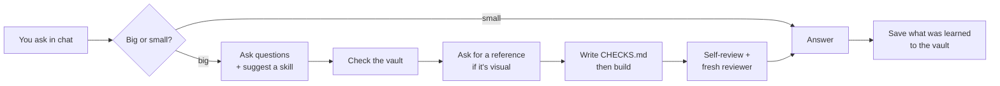
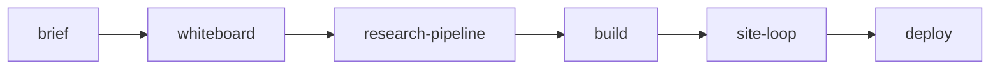

# Obsidian AI Workflow

**Run your AI agent with an Obsidian vault as its memory.** One rules file and a set of skills tell your coding agent to work the way mine does: ask before guessing, remember everything in the vault, check its own work, and never post or pay without asking.

Made by **Huzi**. I have ADHD, so the whole system is built around one idea: I shouldn't have to remember anything, read long notes, or dig for the answer. The AI does the remembering, and every reply starts with the answer and ends with one next step I can do in 2 minutes.

> I use this workflow daily with **Claude Code**, and this package was smoke-tested there (rules load, skills found). The rules are plain Markdown, so Codex, Gemini CLI, Grok and others *should* work too, but I haven't tested them. If you try one, an issue saying what worked would help.

---

## What's inside

| Path | What it is |
|---|---|
| [`AGENTS.md`](AGENTS.md) | **The rules.** One file every AI tool reads: vault, routine, answer format, research, build and safety rules. |
| [`CLAUDE.md`](CLAUDE.md), [`GEMINI.md`](GEMINI.md) | Tiny pointers that load `AGENTS.md` in Claude Code and Gemini CLI. |
| Skills | **Not in this repo any more.** The 10 skills (brief, where, save-note, whiteboard, research-pipeline, site-loop, deploy, prove-test, missed-links, vault-check) now live in **[site-loop-kit](https://github.com/huzi53/site-loop-kit)**, so there's one up-to-date copy. Setup step 2 copies them in. |
| [`vault-template/`](vault-template/) | An empty starter vault: index, one example project hub with Research / Decisions / Open Questions notes. |
| `.gitignore` | Keeps your `vault/` and `.env` files out of git. |

---

## The flow

Every request goes through the same routine. Small things (a question, a quick edit) skip straight to the answer.



For big projects, the skills chain together:



How the vault is laid out:

```
vault/
├── 00 Index.md                     ← front door: one line per project
├── Projects/
│   └── Bakery Site/
│       ├── Bakery Site.md          ← hub: what, where, status, next step
│       ├── Bakery Site Research.md ← raw findings, every claim has a URL
│       ├── Bakery Site Decisions.md← dated decisions with the why
│       └── Bakery Site Open Questions.md
├── Reference/                      ← research not tied to a project
└── Archive/                        ← raw originals; the AI doesn't read these
```

---

## The mindset

These are the ideas behind the rules. Each one came from something going wrong.

1. **The vault is the AI's memory, not your homework.** You never open the notes. You ask in chat, and the AI searches the vault and answers. If the AI says "read note X", the rules are broken.
2. **Ask before guessing.** A wrong guess costs more than a 30-second question. Big tasks start with clickable questions and a one-line "here's what I'll make" that you approve.
3. **Checks before code.** Before building or fixing anything, the AI writes 5-10 pass/fail checks. After every fix, it re-runs them all. This stops fixes from breaking things that already worked.
4. **Proof over vibes.** Every research claim needs a URL the AI actually opened. Anything it couldn't open is marked "not checked", never quietly assumed.
5. **Fresh eyes before "done".** The AI that built something is the worst judge of it. A separate reviewer that sees only the result catches what the builder missed.
6. **You stay in control of anything outside your computer.** Push, post, send, pay, delete: always ask first, every time. Commits stay local until you say so.
7. **Build around your real limits.** Write your limits (your computer, free tools only, testing on your phone) into `AGENTS.md`. The AI checks every plan against them before starting.
8. **Answer first, one next step.** Lead with the answer, show progress with ✅, give real time estimates, and end with one action that takes under 2 minutes. Built for ADHD, and it works for everyone.

---

## Set it up (10 min)

The cloned folder is your workspace: start every AI session inside it, so the rules, skills and vault are all in one place.

1. **Get the files.** Clone the repo (or download the ZIP):
   ```
   git clone https://github.com/huzi53/obsidian-ai-workflow
   ```
2. **Get the skills.** Clone [site-loop-kit](https://github.com/huzi53/site-loop-kit) into your home folder (its tools look for it there), then copy its `skills/` folder into this repo as `skills/` (git-ignored here):
   ```
   cd ~
   git clone https://github.com/huzi53/site-loop-kit
   ```
   Claude Code users can install them as a plugin instead: see the [site-loop-kit README](https://github.com/huzi53/site-loop-kit#install).
3. **Make your vault.** Copy `vault-template/` to a new folder called `vault/` inside the repo. `vault/` is git-ignored, so your private notes never get pushed. Open it in [Obsidian](https://obsidian.md) if you like; the AI only needs the folder. Keep `vault-template/` as is: the AI copies it for each new project. Already have a vault? Put its path in `AGENTS.md` instead.
   Put the code for each project in `projects/<name>/` (also git-ignored), each as its own git repo, so the AI's local commits land there and not in this one.
4. **Fill in `AGENTS.md`.** Replace the 4 `FILL IN` lines at the top: your name, vault path, country and limits.
5. **Start your AI tool in the repo folder.** It picks up the rules like this:

| Tool | How it picks up the rules | Skills |
|---|---|---|
| **Claude Code** (tested) | Reads `CLAUDE.md`, which loads `AGENTS.md` | Install the site-loop-kit plugin, or copy `skills/*` to `.claude/skills/`, then type `/brief` etc. |
| **Codex CLI** | Reads `AGENTS.md` on its own | Type `brief` or "run brief" (AGENTS.md tells it where the skill files are) |
| **Gemini CLI** | Reads `GEMINI.md`, which loads `AGENTS.md` | Say "follow skills/brief/SKILL.md" |
| **Any other agent** (Grok, Cursor, Copilot...) | Tell it at the start: "Read AGENTS.md and follow it" | Say "follow skills/<name>/SKILL.md" |

6. **Try it.** Start a session and type `where`, then ask for something small. You should get the answer first and one next step at the end.

### Optional: install the ADHD skill

The answer format in `AGENTS.md` pairs with **[i-have-adhd](https://github.com/ayghri/i-have-adhd)** by Ayoub G. It's a separate skill that shapes every reply for an ADHD reader, and it supports Claude Code, Codex, Grok, Gemini CLI, Cursor, Copilot and more. Follow its [install guide](https://github.com/ayghri/i-have-adhd/blob/main/INSTALL.md) for your tool. When both are on, it handles the style and `AGENTS.md` handles the workflow.

---

## The skills

The skills live in [site-loop-kit](https://github.com/huzi53/site-loop-kit) (setup step 2 copies them in). Each is a plain Markdown file with step-by-step instructions. Tools that support `SKILL.md` folders load them as commands; any other tool can just be told "follow skills/<name>/SKILL.md".

| Skill | When to use it |
|---|---|
| [`brief`](https://github.com/huzi53/site-loop-kit/blob/main/skills/brief/SKILL.md) | Before a big or vague task: 3 lines (goal, format, tools), then wait for OK |
| [`where`](https://github.com/huzi53/site-loop-kit/blob/main/skills/where/SKILL.md) | Back from a break or lost: goal, done ✅, now, next 2-min step |
| [`save-note`](https://github.com/huzi53/site-loop-kit/blob/main/skills/save-note/SKILL.md) | Anything worth remembering, filed into the right vault note |
| [`whiteboard`](https://github.com/huzi53/site-loop-kit/blob/main/skills/whiteboard/SKILL.md) | Plan a big project in phases on an Obsidian canvas, tagged solo or team |
| [`research-pipeline`](https://github.com/huzi53/site-loop-kit/blob/main/skills/research-pipeline/SKILL.md) | Deep research with your named tools, a verifier, and a vault save |
| [`site-loop`](https://github.com/huzi53/site-loop-kit/blob/main/skills/site-loop/SKILL.md) | Score-and-fix a website with 5 critics, up to 6 rounds, aiming for 8/10+ |
| [`deploy`](https://github.com/huzi53/site-loop-kit/blob/main/skills/deploy/SKILL.md) | Test, secret-scan, deploy the public folder only, commit locally |
| [`prove-test`](https://github.com/huzi53/site-loop-kit/blob/main/skills/prove-test/SKILL.md) | Test a tool from a post against *your* bar before you invest in it |
| [`missed-links`](https://github.com/huzi53/site-loop-kit/blob/main/skills/missed-links/SKILL.md) | List vault notes that name another note without linking it |
| [`vault-check`](https://github.com/huzi53/site-loop-kit/blob/main/skills/vault-check/SKILL.md) | Health check of the vault: broken links, missing frontmatter, stale notes |

Make your own: copy any skill folder, rename it, and rewrite the steps. Keep the `name` and `description` lines at the top so tools can find it.

---

## License

MIT. Use it, change it, share it; just keep the [LICENSE](LICENSE) file in copies.
